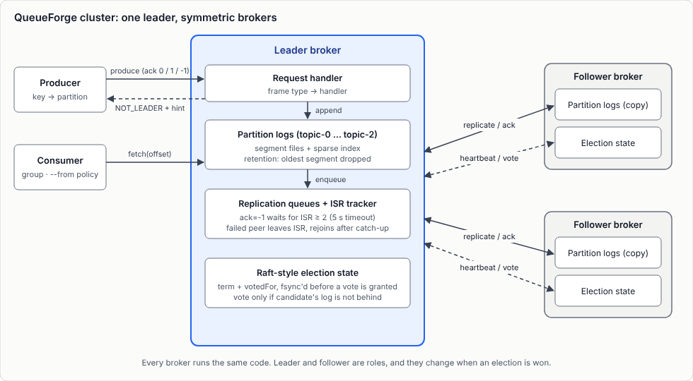

# QueueForge

A Kafka-style distributed message queue built from scratch in Java, using raw TCP sockets and no messaging framework. A cluster of symmetric brokers stores messages in partitioned, append-only logs, elects a leader with a Raft-style election, and replicates data to followers with ISR-based acknowledgements.

This is a learning and systems-design project. It aims to implement the core ideas behind Kafka (log storage, replication, leader election, consumer offsets) in a codebase small enough to read end to end. It is not production software; see [Known limitations](#known-limitations).

## Contents

- [Features](#features)
- [Architecture](#architecture)
- [How it works](#how-it-works)
- [Quick start](#quick-start)
- [Benchmarks](#benchmarks)
- [Design decisions](#design-decisions)
- [Known limitations](#known-limitations)
- [Roadmap](#roadmap)
- [Project layout](#project-layout)

## Features

**Storage**
- Append-only segment log per partition, with a sparse offset index (one entry every 100 messages) and binary-search lookup
- Crash recovery: the active segment is scanned on startup and any incomplete tail record is truncated
- Segment-based retention (oldest segment is deleted once the limit is reached)

**Replication and consistency**
- Leader-driven replication to followers
- Acknowledgement levels: `0` and `1` (leader only), `-1` (all in-sync replicas)
- In-Sync Replica (ISR) tracking: replicas that fail are removed, and rejoin after catching up. `ack=all` requires at least 2 in-sync replicas (leader included) and times out after 5 s
- Log-driven follower catch-up: a restarted follower reports its next offset and the leader streams the missing range from its own log

**Leader election**
- Raft-style election: terms, one vote per term, randomized election timeout (3 to 5 s), 1 s heartbeats
- `term` and `votedFor` are persisted before a vote is granted (temp file, fsync, atomic rename), so a restart cannot cause a double vote
- Log-freshness check: a node refuses to vote for a candidate whose log is behind its own on any partition

**Clients**
- Producer with key-based partitioning and automatic redirect to the current leader (`NOT_LEADER` plus leader hint)
- Consumer groups with partition assignment
- Offset-based fetch with distinct results for "caught up" and `OFFSET_OUT_OF_RANGE` (data removed by retention)
- `ListOffsets` API (earliest and latest offset per partition) and start policies: `earliest`, `latest`, or an exact offset
- Hardening: connect and read timeouts on clients, and a maximum frame size guard on the wire protocol

**In progress:** committed consumer offsets stored in an internal replicated topic (`__consumer_offsets`). See the [Roadmap](#roadmap).

## Architecture



*One leader handles client requests, appends to partition logs and replicates to followers. Leader and followers exchange heartbeats and votes for election.*

### Wire protocol

Every message is a length-prefixed frame:

```
[4 bytes: length][1 byte: message type][payload]
```

Message types include `PRODUCE`, `FETCH`, `REPLICATE`, `JOIN_GROUP`, `REQUEST_VOTE`, `HEARTBEAT` and `LIST_OFFSETS`, each with its own response type. Frames larger than 10 MB are rejected as a protocol error.

## How it works

**Write path.** The producer sends a record. The leader picks a partition (hash of the key, or random when there is no key), appends the record to that partition's log, and queues it for every follower. With `ack=-1` the leader waits until the in-sync replicas have acknowledged the record before replying. If fewer than 2 replicas are in sync, the request is rejected with an explicit error code instead of silently weakening the guarantee.

**Storage layout.** Each partition is a directory of segments (`segment-<startOffset>.log` plus a matching `.index`). A read finds the right segment, binary-searches the sparse index for the nearest earlier entry, and scans forward from there.

**Failure handling.** When a leader dies, followers stop receiving heartbeats and a randomized timeout fires on one of them. That node increments its term, votes for itself, and asks the others for votes. A peer grants its vote only if the candidate's term is current, it has not voted for someone else in that term, and the candidate's log is at least as advanced as its own on every partition. The candidate with a majority becomes leader.

**Consumer reads.** A consumer fetches by `(topic, partition, offset)`. The response distinguishes three cases: a record, "caught up" (offset equals the log end), and `OFFSET_OUT_OF_RANGE` (offset older than the earliest retained record, or beyond the log end). Out-of-range responses carry the earliest and latest offsets so the client can reset according to its start policy.

## Quick start

**Requirements:** JDK 17 or newer, Maven (or the included `mvnw` wrapper).

```bash
./mvnw compile
```

**Start three brokers** (three terminals). Arguments are `<port> <comma-separated addresses of the other brokers>`:

```bash
java -cp target/classes com.pr_reviewer.queueforge.broker.BrokerServer 9092 localhost:9093,localhost:9094
java -cp target/classes com.pr_reviewer.queueforge.broker.BrokerServer 9093 localhost:9092,localhost:9094
java -cp target/classes com.pr_reviewer.queueforge.broker.BrokerServer 9094 localhost:9092,localhost:9093
```

Wait about 10 seconds for a leader to be elected. Each broker stores its data under `data/data-<port>/`.

**Produce messages** (interactive, `key:value` or just `value`):

```bash
java -cp target/classes com.pr_reviewer.queueforge.client.ProducerClient \
  localhost:9092,localhost:9093,localhost:9094 orders
> user1:hello
```

**Consume messages:**

```bash
java -cp target/classes com.pr_reviewer.queueforge.client.ConsumerClient \
  localhost:9092,localhost:9093,localhost:9094 consumer-1 group-1 orders --from earliest
```

`--from` accepts `earliest` (default), `latest`, or an exact offset.

**Inspect a single record** with the probe tool:

```bash
# <host:port> <topic> <partition | key:KEY> <offset | earliest | latest>
java -cp target/classes com.pr_reviewer.queueforge.test.FetchProbe localhost:9093 orders key:user1 0
```

**Try a failover:** stop the leader's process, wait 10 to 12 seconds, and keep producing. One of the remaining brokers becomes leader and clients are redirected to it.

## Benchmarks

Measured with `LoadTestProducer` (a single-threaded, synchronous producer: one request in flight at a time) against 3 brokers running on one laptop, so network cost is close to zero and results reflect this implementation, not a real cluster. Each figure is from 100,000 messages, 5 consecutive runs on a warm cluster.

| Ack level | Throughput (median) | p50 latency | p99 latency |
|---|---|---|---|
| `ack=0` | about 14,000 msgs/s | 0.06 ms | 0.19 ms |
| `ack=-1` (all in-sync replicas) | about 1,900 msgs/s | 0.47 ms | about 1 ms |

With two producers in parallel, `ack=-1` throughput rose to about 4,250 msgs/s in total (roughly 2.2x), which shows the single producer is latency-bound rather than the broker being saturated.

```bash
java -cp target/classes com.pr_reviewer.queueforge.test.LoadTestProducer \
  localhost:9092,localhost:9093,localhost:9094 bench 100000 -1
```

Throughput work (batching, pipelining, replication batching) is deliberately postponed until the feature set is complete. These numbers are the baseline to beat.

## Design decisions

| Decision | Choice | Why |
|---|---|---|
| Election safety | Vote only for candidates whose per-partition log ends are not behind the voter's | Prevents electing a leader that would lose acknowledged data. Cheaper than leader-epoch tracking inside records |
| Persisting Raft state | Fsync on term or vote change only (election path) | Avoids double voting after a restart, with no cost on the write path |
| Follower catch-up | Follower reports its next offset, leader streams from its own log | Simple, handles any gap size, and duplicates are acknowledged safely |
| `ack=all` | ISR-based with a minimum of 2 in-sync replicas and an explicit error code | Failing loudly is safer than acknowledging a write that exists on one node |
| Fetch results | Separate "caught up" from `OFFSET_OUT_OF_RANGE` | A slow consumer must not silently skip data removed by retention |
| Partitioning | One shared key-to-partition function used by broker and tools | Prevents the broker and CLI tools from disagreeing on where a key lives |
| Consumer offsets (in progress) | Internal replicated topic, leader-only, rebuilt from the log on leader change | Commits survive leader failure and restarts; reuses the existing replication path |

## Known limitations

This project is honest about what it does not do yet:

- **Not full Raft.** Only leader election follows Raft. Data replication is ISR-style, and the ISR itself is not persisted or replicated, so a new leader assumes all peers are in sync.
- **No divergent-log truncation.** A follower holding records that the leader does not have cannot be repaired automatically.
- **No pre-vote.** A node that rejoins with a higher term can force a healthy leader to step down.
- **Retention can outrun a lagging follower.** Old segments are deleted regardless of whether a follower still needs them.
- **`ack=0` and `ack=1` behave the same.** Both reply once the leader has written the record.
- **No idempotent producer.** A retry after a timeout can write a duplicate.
- **No high watermark.** Consumers can read records that are not yet fully replicated.
- **Consumer group membership lives in the leader's memory** and is not rebuilt after failover. There is no heartbeat-based dead-consumer detection yet.
- **Fixed topology.** Three partitions per topic, and retention is hardcoded (1,000 messages per segment, 5 segments).
- **Consistent hashing** is implemented as a class but not yet used for partition-to-leader placement.
- **Single sender thread per follower**, and the replication queue is unbounded.

## Roadmap

Planned in this order:

1. **Consumer offsets** (in progress): `OFFSET_COMMIT` and `OFFSET_FETCH`, stored in the `__consumer_offsets` topic, with at-least-once semantics (commit after processing)
2. Consumer-group hardening: group state surviving failover, heartbeats, dead-consumer expiry and rebalancing
3. Core hardening: pre-vote, divergent-log truncation, retention aware of follower progress, configurable constants
4. Architecture: high watermark, idempotent producer, real `ack=0` versus `ack=1` semantics, topic admin API
5. Quality: unit and integration tests, logging cleanup, removal of unused dependencies
6. Performance: batching, pipelining, bounded and batched replication

## Project layout

```
src/main/java/com/pr_reviewer/queueforge/
  broker/     BrokerServer (request handling, replication, ISR, election hooks), Partition (segment log)
  raft/       RaftState (term, vote, role, persistence), ElectionTimer
  protocol/   Frame, MessageType, request and response classes, Partitioner
  client/     ProducerClient, ConsumerClient
  test/       LoadTestProducer, FetchProbe and other manual test tools, unit tests
```

## Tech

Java, Maven, raw `java.net` sockets and `java.nio` file channels. The broker itself uses no framework; the Spring Boot dependencies in `pom.xml` are leftovers from the initial scaffold and are not used by the broker.